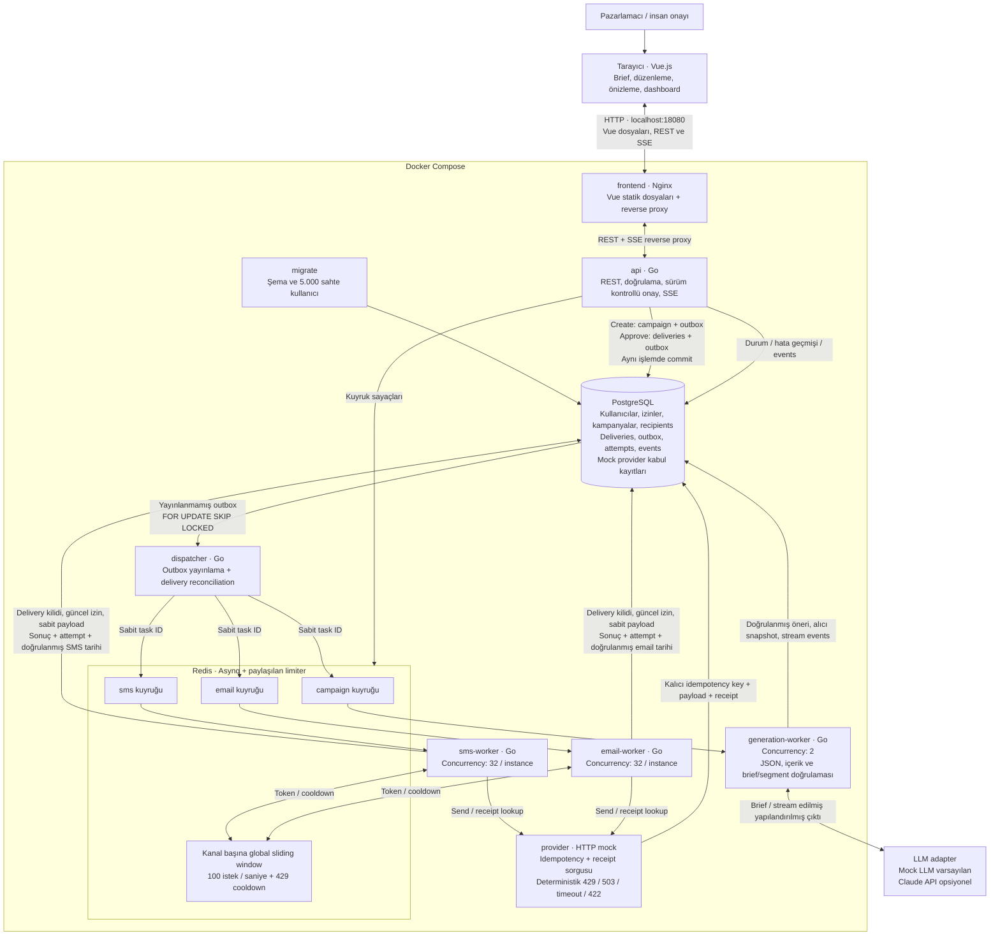

# Mimari

Bu diyagramlar mevcut uygulamayı anlatır. Go servisleri aynı kod tabanının farklı process rolleridir; Compose içinde çalışırlar. Claude çağrısı tarayıcıdan değil generation worker’dan yapılır. Gerçek alıcıya mesaj gönderilmez.

## Servisler ve veri akışı



## Kampanya yaşam döngüsü

```mermaid
sequenceDiagram
  autonumber
  actor Human as Pazarlamacı
  participant UI as Vue
  participant API as Go API
  participant PG as PostgreSQL
  participant D as Dispatcher
  participant Q as Redis / Asynq
  participant G as Generation worker
  participant L as Mock LLM / Claude
  participant W as SMS veya email worker
  participant P as Provider adapter

  Human->>UI: Brief yaz
  UI->>API: POST /api/campaigns
  API->>PG: TX: campaign + generation outbox
  PG-->>API: Commit
  API-->>UI: 202 + campaign ID
  D->>PG: SKIP LOCKED ile outbox al
  D->>Q: campaign:generate, sabit task ID
  D->>PG: published_at commit
  Q->>G: Job claim
  G->>L: Brief ile üret
  L-->>G: Yapılandırılmış çıktı / içerik parçaları
  G->>PG: generation.started + content.delta events
  G->>G: JSON/domain + şehir/gün tutarlılığı kontrolü
  alt Çıktı hatalı
    G-->>Q: Sınırlı retry, sonra campaign failed + event
  else Çıktı geçerli
    G->>PG: Parametreli segment sorgusu, recipients snapshot, draft
  end
  API->>PG: Kampanya events ve snapshot oku
  API-->>UI: SSE: içerik / draft / hata
  Human->>UI: İçeriği düzenle, önizle, onayla
  UI->>API: PATCH içerik; POST approve + version
  API->>API: İçerik + brief/segment kontrolü
  API->>PG: Campaign FOR UPDATE; sürüm kontrolü
  API->>PG: TX: approved + unique deliveries + outbox
  D->>PG: Mesaj outbox kayıtlarını al
  D->>Q: sms / email kuyruklarına yayınla
  Q->>W: Mesaj job claim
  W->>PG: Session advisory lock + fencing token
  W->>P: Önceki deneme varsa receipt lookup (destekleniyorsa)
  alt Önceki kabul doğrulandı
    W->>PG: TX: accepted + attempt + ilgili kanal tarihi
  else Yeni gönderim güvenle yapılabilir
    W->>Q: Kanal genelinde 100/s limiter kontrolü
    W->>PG: Render, sabit payload ve inflight attempt commit
    W->>PG: Güncel consent FOR SHARE
    alt İzin iptal
      W->>PG: suppressed; provider çağrılmaz
    else İzin var
      W->>P: Send, Idempotency-Key = delivery ID
      alt Kabul doğrulandı
        P-->>W: Receipt ID
        W->>PG: TX: accepted + attempt + kullanıcı kanal tarihi
      else Kalıcı ret
        W->>PG: failed + hata nedeni
      else Geçici / belirsiz hata
        alt Provider idempotency garantisi veriyor
          W->>PG: retrying + next_attempt_at + attempt
          W-->>Q: Asynq delayed retry, backoff / jitter
        else Provider idempotency garantisi vermiyor
          W->>PG: unknown; otomatik tekrar yok
          Note over UI,PG: Manuel inceleme; campaign needs_review
        end
      end
    end
  end
  API->>PG: Dashboard durumu ve hata geçmişi
  API->>Q: Gerçek kuyruk sayaçları
  API-->>UI: SSE: değişen dashboard snapshot
  Note over UI,API: Yeniden bağlantıda güncel tam snapshot
```

## Güvenilirlik kuralları

- **PostgreSQL kaynak gerçektir.** Create ve approve, ilgili outbox kayıtlarıyla aynı transaction’da commit edilir. Redis’e publish ile DB acknowledgment arasında çökme, sabit task ID ve delivery/provider idempotency ile toparlanır.
- **Onay zorunludur.** JSON/domain doğrulaması ve açık şehir/gün tutarlılığı üretimde; içerik/domain ve brief tutarlılığı son onayda kontrol edilir. LLM çıktısı SQL olarak çalıştırılmaz; recipients sabitlenir. Bu kontrol serbest doğal dil anlamının tamamı için garanti değildir.
- **İzin ve kilit.** Worker delivery başına session advisory lock ve fencing token kullanır. Provider çağrısından önce consent FOR SHARE ile tekrar okunur. İptal commit’inden sonraki işler gönderilmez; zaten başlamış gönderimin geri alınacağı vaat edilmez.
- **Retry ve belirsizlik.** Kalıcı hatalar failed, izin iptali suppressed olur. Idempotency garantili adaptörde geçici hatalar DB retry zamanı ve Asynq backoff/jitter ile denenir; önceki kabul receipt ile toparlanır. Garantisi olmayan adaptörde belirsiz/yarım deneme unknown olur, otomatik Send durur; kampanya inceleme gerektirir. Yalnız receipt lookup desteği güvenli resend garantisi sayılmaz.
- **Kanal tarihi.** Delivery accepted, attempt sonucu ve ilgili users.last_sms_sent_at / last_email_sent_at aynı transaction’da yazılır. Provider kabulü gerçek alıcı teslimatı değildir.
- **Concurrency ve hız farklıdır.** Asynq goroutine concurrency’si worker instance başınadır; Redis limiter her kanalın bütün instance’larına ortak 100 istek/saniye uygular. SMS ve email limitleri bağımsızdır. 429 ortak cooldown oluşturur ve hata bütçesini tüketmez.
- **Kuyruk ömrü.** Varsayılan CAMPAIGN_TTL=0s otomatik expiry yapmaz; ihtiyaç halinde açık bir süre tanımlanır. Asynq tamamlanmış iş retention’ı kampanyanın gönderim ömrü değildir. 10 milyon/kanal teorik minimum 27 saat 46 dakika 40 saniyedir; gerçek süre daha uzun olabilir.
- **SSE.** Kampanya stream’i PostgreSQL event ID’leriyle replay ve snapshot sağlar. Dashboard stream’i her bağlantıda tam güncel snapshot gönderir; tarayıcı polling yapmaz. Sunucu DB/Asynq durumunu 500 ms aralıkla ölçer, değişen snapshot’ı gönderir; bu bir native Asynq push aboneliği değildir.
- **Reconciliation sınırı.** Dispatcher dakikada bir, en az 10 dakikadır ilerlemeyen nonterminal delivery’leri DB’den yeniden kuyruğa alabilir. Redis kaybında generation işlerinin yeniden kurulması mevcut sürümde otomatik değildir.

## Kaynak dosyaları

- [Servis diyagramı](docs/architecture.mmd)
- [Kampanya sequence diyagramı](docs/campaign-flow.mmd)

GitHub Markdown, Mermaid bloklarını doğrudan render eder. .mmd dosyaları ayrıca bir Mermaid editörüne aktarılabilir.
