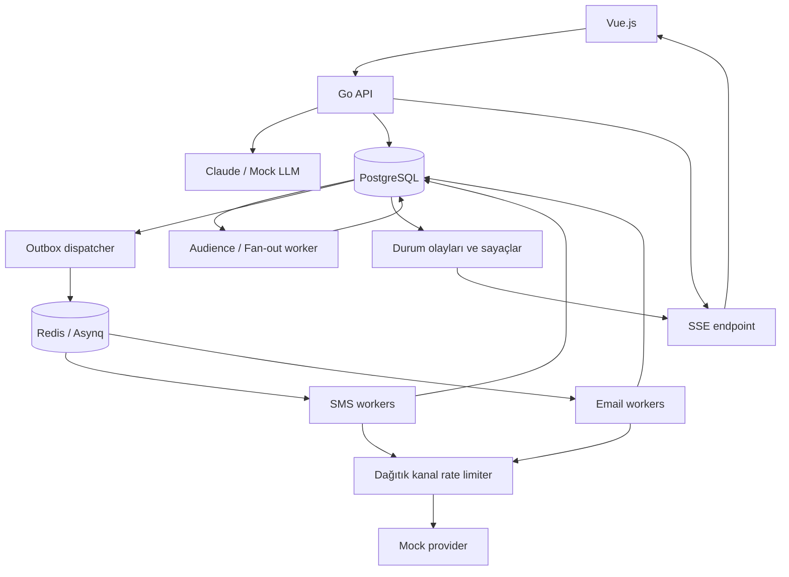
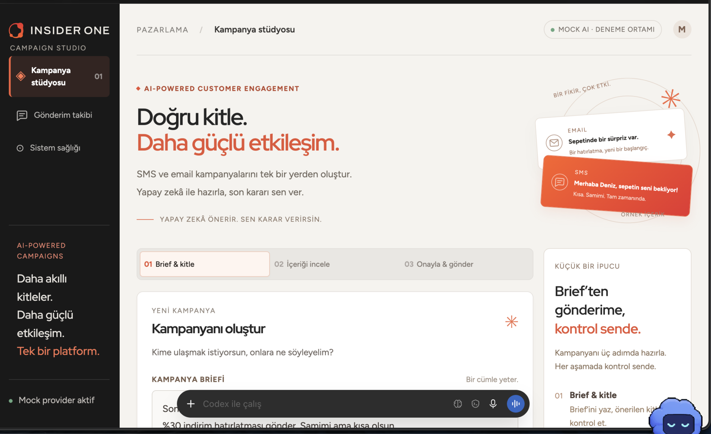
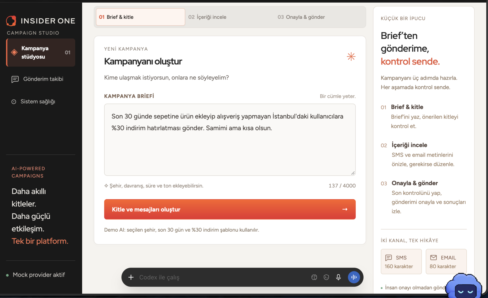
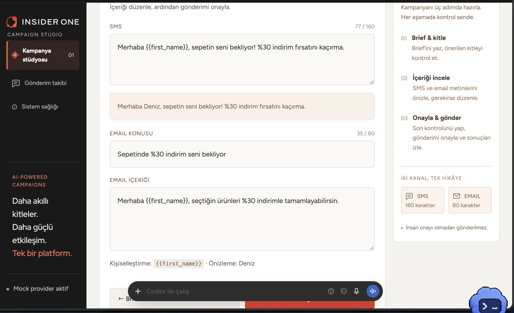
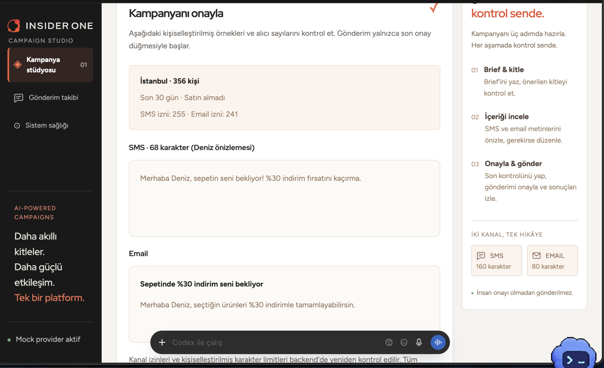
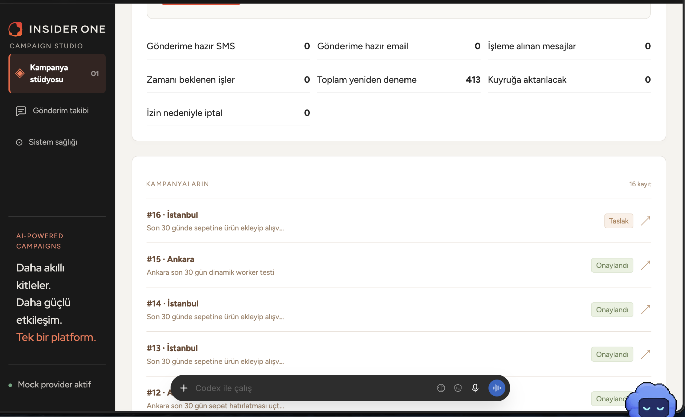
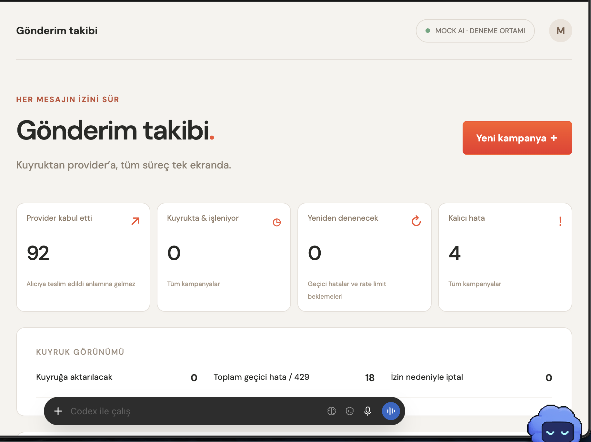
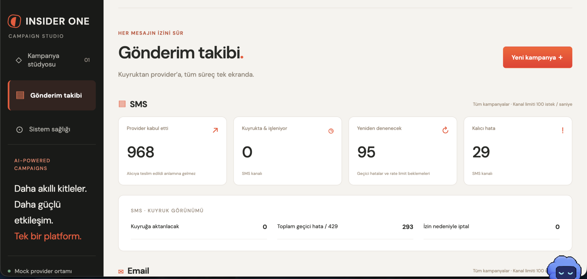
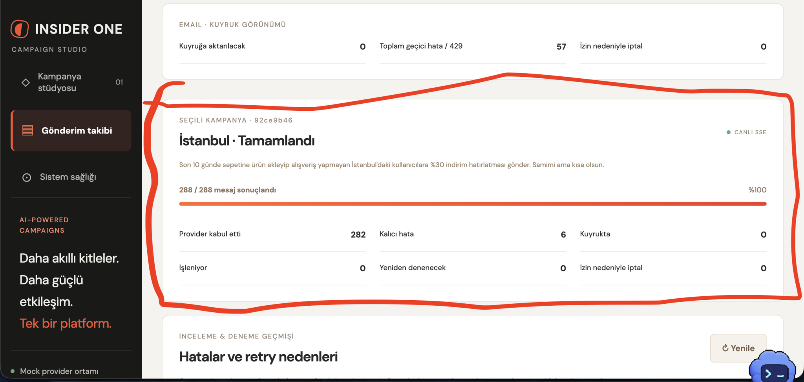
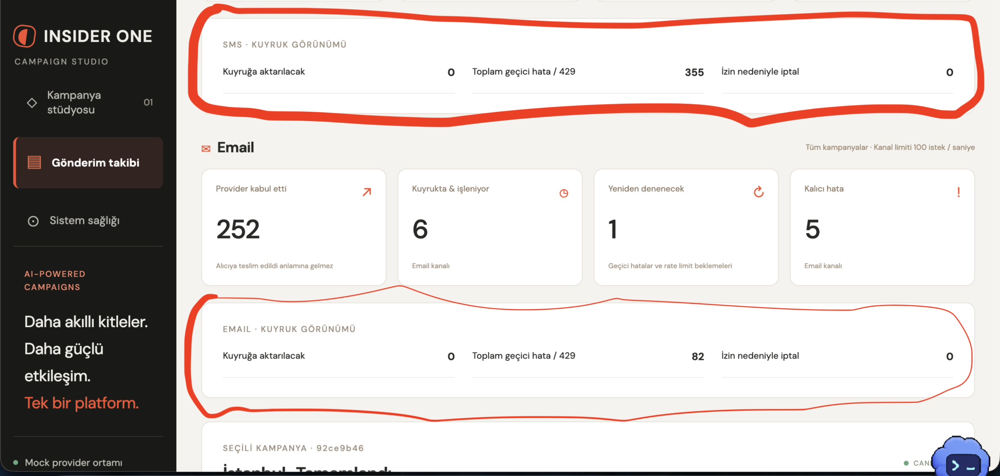

# Insider One — güncellenmiş konuşma export’u

Export: 2026-10-27T13:47:54.520591+03:00

Kullanıcı mesajları ve görünür asistan yanıtları. Sistem/developer talimatları, araç çıktıları ve iç muhakeme dahil değildir. Son push doğrulamasından önce alınmış snapshot.

## 1. Kullanıcı

selam

## 2. Asistan

Selam! Nasıl yardımcı olabilirim?

## 3. Kullanıcı

## İş bağlamı

Insider One müşterileri her gün milyonlarca kişiye SMS ve email gönderiyor. Bir kampanya hazırlamak için kitleyi tanımlamak, her kanal için metin yazmak ve karakter limitlerine uymak gerekiyor. Bu case'te pazarlamacının yalnızca ne istediğini yazdığı, gerisini Claude'un önerdiği ve son kararı insanın verdiği bir araç kurmanı istiyoruz.

## Kullanıcı akışı

Örnek brief

*“Son 30 günde sepetine ürün ekleyip alışveriş yapmayan İstanbul'daki kullanıcılara %30 indirim hatırlatması gönder. Samimi ama kısa olsun.”*

1. **Kitle çıkarılır**Claude brief'ten bir segment kuralı üretir, arayüz kaç kişiye gideceğini gösterir.
2. **Mesajlar üretilir**SMS ve email içeriği ekrana stream edilerek akar.
3. **İnsan onaylar**Pazarlamacı önizler, gerekirse düzenler ve onaylar.
4. **Gönderilir**Mesajlar kuyruk üzerinden mock provider'a gönderilir.
5. **Canlı izlenir**Dashboard gönderim durumunu gösterir.

Gerçek kimseye mesaj gitmez. Alıcılar senin oluşturacağın sahte kullanıcılardır, gönderim de senin yazacağın mock provider'a yapılır.

## Fonksiyonel gereksinimler

### Kitle

- Claude'un ürettiği segment kuralı backend'de doğrulanır; LLM çıktısı doğrudan SQL olarak çalıştırılmaz.
- İzni olmayan kullanıcıya o kanaldan mesaj gönderilmez.

### İçerik

- İçerik kanal limitlerine uymalı: SMS en fazla 160 karakter, email konusu en fazla 80 karakter.
- `{{first_name}}` gibi kişiselleştirme değişkenleri desteklenir.

### Gönderim

- Asenkron kuyruk, kanal başına saniyede en fazla 100 mesaj.
- Aynı kişiye aynı mesaj iki kez gitmez. Retry stratejisini sen tasarla.

### Takip

- Canlı gönderim durumu, metrics ve health check endpoint'leri.

## AI gereksinimleri

Case'in en önemli kısmı. Claude'u çağırmak yeterli değil; çıktısını güvenilir hale getirmeni bekliyoruz.

- **Doğrulama:** Claude'un çıktısı yapılandırılmış (JSON) olmalı ve backend'de kontrol edilmeli.
- **Test edilebilirlik:** testler gerçek API key olmadan, mock bir LLM ile çalışmalı.

## Kaynaklar

**Claude API key:** Uygulama key'i `.env` dosyasındaki `ANTHROPIC_API_KEY` değişkeninden okumalı; repoya bir `.env.example` ekle. Geliştirme sırasında mock bir LLM ile çalışabilir, gerçek modelle denemek istersen [Claude Console](https://platform.claude.com/)'dan kendi API key'ini alabilirsin.

Aşağıdakileri de kendin hazırlayacaksın:

- **Sahte kullanıcı verisi:** birkaç bin kullanıcılık bir seed. Hangi alanlara ihtiyaç olduğuna (ad, email, telefon, şehir, alışveriş geçmişi, kanal izinleri gibi) sen karar ver.
- **Mock SMS/email provider:** gerçek bir servisi taklit eden basit bir servis. Retry ve rate limit mantığını gerçekten test edebilmek için zaman zaman hata, gecikme ve 429 döndürmeli.

## Teknoloji

Frontend Vue.js, backend Go veya PHP. Veritabanı, kuyruk ve kütüphaneler senin seçimin.

## Teslim edilecekler

- GitHub veya GitLab repository
- `docker compose up` ile tek komutla kurulum (seed verisi ve mock provider dahil)
- `make test` ile çalışan testler
- `README.md`: kurulum ve kısa mimari özeti
- `DECISIONS.md`: önemli kararların ve nedenleri
- `ai-sessions/`: Claude session export'ların (aşağıya bakın)


Insider one şirketi için böyle bir proje yapmam isteniyor

front endden atılacak request öncelikle claude api ye gidecek burada istenilen speclere göre bir çıktı üretilecek bu json dosyası backendde valide edildikten sonra bir sql query için segmentler belirlenecek ve frontend e bir response dönecek

bu response daha sonrasında kullanıcı tarafından onaylanıp mesajlar backendde kişi ismine göre customize edilip async bir kuyruğa gönderilmeli

sms ve email için iki ayrı kanal oluşturulmalı ve queue lara register olmuş workerlar kendi işlerini yapmalı

bunun yanında sse ile front end tarafına süreç hakkında bilgi stream edilmeli

insider one production grade ürününde milyonlarca insana email ve sms yollayabiliyor. bunun için bana reliable ve scalable bir mimari önerebilir misin.

tech stack olarak front endde vue.js, backend tarafında go, kuyrukları store etmek için redis ve asynco librarysini kullan ve kullanıcı verilerini saklayabilmek için de postgre sql kullan

## 4. Asistan

Go, PostgreSQL, Redis ve Asynq üzerine; insan onayını, güvenilir gönderimi ve canlı takibi kapsayan bir mimari önereceğim. Önce ilgili araçların güncel davranışlarını kontrol edip case için gerekli kapsamı milyonlarca alıcıya ölçekleme adımlarından ayıracağım.

## 5. Asistan

Evet. Bu stack için önerim: **Go ile modüler bir backend, ayrı çalışan SMS/email worker havuzları, PostgreSQL’i kalıcı doğruluk kaynağı olarak kullanan bir outbox yapısı ve Redis üzerinde Asynq.**

Buradaki en kritik karar şu: **Claude kampanyayı önerir; backend doğrular, insan onaylar ve yalnızca onaylanmış sürüm gönderilir.**

“Asynco” ile Go kütüphanesi **Asynq**’u kastettiğini varsayıyorum.



**1. Frontend doğrudan Claude’a gitmemeli**

Akışı şöyle kurmanı öneririm:

```text
Vue → Go API → Claude → Backend validation → PostgreSQL → Vue
```

Böylece API key backend’de kalır; timeout, kullanım limiti, prompt sürümü, loglama ve doğrulama tek yerde yönetilir.

İlk istek:

```http
POST /api/campaigns
{
  "brief": "Son 30 günde..."
}
```

Yanıt:

```http
202 Accepted
{
  "campaign_id": "...",
  "status": "generating"
}
```

Vue ardından kampanyanın SSE bağlantısını açar. Claude çağrısını HTTP isteğinin yaşam süresine bağlamak yerine ayrı bir `campaign:generate` işi olarak çalıştırabilirsin.

Bu iş yeniden çalışırsa aynı kampanya sürümünü ikinci kez yayınlamamalı; üretim denemeleri ayrı tutulmalı ve başarılı çıktı atomik olarak kaydedilmeli.

**2. Claude’dan SQL değil, sınırlı bir segment dili al**

İlk sürümde genel amaçlı, sınırsız bir filtre ağacı yerine desteklediğin iş kurallarını açıkça tanımla:

```json
{
  "schema_version": 1,
  "segment": {
    "city": "Istanbul",
    "cart_added_within_days": 30,
    "exclude_purchased_carts": true
  },
  "messages": {
    "sms": {
      "body": "Merhaba {{first_name}}, sepetindeki ürünlerde %30 indirim seni bekliyor!"
    },
    "email": {
      "subject": "{{first_name}}, sepetinde %30 indirim var",
      "body": "..."
    }
  }
}
```

Burada “alışveriş yapmayan” ifadesinin anlamını ürün kararıyla netleştirmelisin: Sepetin satın alınmamış olması mı, kullanıcının son 30 günde hiçbir alışveriş yapmaması mı? Arayüzde üretilen segmenti doğal dille göstererek bu yorumu onaylat.

Backend doğrulamaları:

- JSON Schema: tipler, zorunlu alanlar, bilinmeyen alanların reddi.
- İş kuralları: izin verilen şehirler, tarih aralığı, desteklenen segment özellikleri.
- Şablon kuralları: yalnızca izin verilen `{{first_name}}` gibi değişkenler.
- İçerik limitleri ve email HTML güvenliği.
- Segment karmaşıklığı ve sorgu timeout’u.

Claude’un structured output özelliğini kullanabilirsin; ancak şema uyumu, iş kuralı doğruluğunun yerine geçmez. [Claude structured outputs dokümanı](https://platform.claude.com/docs/en/build-with-claude/structured-outputs)

SQL’i backend’deki derleyici üretir. Kolonlar ve operatörler koddan, değerler parametrelerden gelir. Tenant filtresi ve kanal izinleri modele bırakılmaz.

Geçersiz çıktı için doğrulama hatalarıyla en fazla bir düzeltme denemesi yap; yine başarısızsa kampanyayı gönderilebilir duruma geçirme.

**3. Stream edilen içerik ile onaylanabilir içerik farklı aşamalar olmalı**

Claude çıktısı akarken Vue taslak metni gösterebilir. Ancak tamamlanmamış JSON’u çalıştırma veya onaylanabilir kabul etme.

Örnek SSE olayları:

```text
generation.started
content.delta
segment.validated
audience.counted
draft.ready
generation.failed
```

`draft.ready`, yalnızca JSON tamamen alındıktan, doğrulandıktan ve kaydedildikten sonra yayınlanır.

Kullanıcı metni değiştirdiğinde aynı doğrulamalar yeniden çalışır. Önceki onay geçersiz olur.

**4. Onayı değişmez bir kampanya sürümüne bağla**

Önerilen akış:

```text
generating → draft → preparing_audience → ready_for_approval
           → approved → dispatching → completed
```

Üretim hatası, iptal ve kısmi gönderim hatası ayrıca modellenir. `completed`, bütün mesajların terminal duruma gelmesidir; hepsinin başarılı olması değildir.

Her sürümde şunları sakla:

- Segment kuralı ve değerlendirme zamanı.
- SMS/email şablonları.
- Kanal bazında uygun alıcı sayıları.
- Onaylayan kişi ve onay zamanı.
- Prompt, model ve JSON şema sürümü.

**Onay, belirli bir içerik sürümüne ve hazırlanmış alıcı snapshot’ına bağlanmalı.** Milyonlarca alıcıyı tek transaction’da hazırlama; batch’lerle oluştur, tamamlanmadan onayı açma.

Snapshot hedef kitleyi sabitler. Buna rağmen kullanıcı iznini gönderimden hemen önce tekrar kontrol et; izin geri çekildiyse `suppressed` olarak işaretle.

**5. PostgreSQL ve Redis arasına transactional outbox koy**

Şu iki işlem ayrı yapılırsa veri kaybı riski oluşur:

```text
DB’ye kampanyayı kaydet
Redis’e job gönder
```

DB kaydı başarılı olup Redis işlemi başarısız olabilir.

Bunun yerine aynı PostgreSQL transaction’ında:

```text
message_delivery oluştur
outbox kaydı oluştur
COMMIT
```

Dispatcher outbox kayıtlarını alır, Asynq’a gönderir ve yayınlandı olarak işaretler. Birden fazla dispatcher, kısa transaction ve lease yaklaşımıyla kayıtları paylaşabilir; `FOR UPDATE SKIP LOCKED` kuyruk benzeri tablolar için uygundur. [PostgreSQL SELECT dokümanı](https://www.postgresql.org/docs/current/sql-select.html)

Redis’e gönderimden sonra dispatcher çökerse aynı kayıt yeniden enqueue edilebilir. Dolayısıyla **outbox kaybı önler; duplicate ihtimalini idempotency çözer.**

Büyük kampanyalar için fan-out worker:

- Keyset pagination ile örneğin 1.000 alıcılık batch’ler işler.
- Her batch için delivery ve outbox kayıtlarını birlikte yazar.
- İlerleme cursor’unu aynı transaction’da kaydeder.
- Redis kuyruğunun derinliğine göre üretimi yavaşlatır.

Milyonlarca job’ı tek seferde Redis’e doldurma.

**6. SMS ve email için ayrı Asynq worker havuzları kullan**

```text
campaign queue → generation / audience işleri
sms queue      → SMS worker process’leri
email queue    → Email worker process’leri
```

Aynı repository ve Go kod tabanından farklı komutlarla çalıştırabilirsin:

```text
cmd/api
cmd/campaign-worker
cmd/dispatcher
cmd/sms-worker
cmd/email-worker
cmd/mock-provider
```

Bu yapı case için yönetilebilir kalır ve bileşenlerin bağımsız ölçeklenmesini sağlar.

Queue payload’ında mesajın tamamını veya kişisel verileri taşımak yerine:

```json
{
  "delivery_id": "..."
}
```

Worker gerekli değişmez içerik sürümünü PostgreSQL’den okur.

Asynq yeniden deneme ve çöken worker işlerinin kurtarılması gibi mekanizmalar sağlar; uygulama yine de tekrar çalıştırılmaya dayanıklı olmalıdır. [Asynq repository](https://github.com/hibiken/asynq)

**7. “İki kez gitmez” garantisini provider’a kadar taşı**

PostgreSQL’de örneğin:

```sql
UNIQUE (tenant_id, campaign_version_id, user_id, channel)
```

Bu, aynı kampanya sürümündeki aynı kanal mesajının iki kez oluşturulmasını engeller. Farklı kampanyalar arasında da tekrar engellemek istiyorsan ayrıca bir iş kuralı ve deduplication süresi tanımlamalısın.

Her delivery için sabit provider anahtarı üret:

```text
Idempotency-Key: delivery_id
```

Kritik hata senaryosu:

```text
Provider mesajı kabul etti
Worker, sonucu DB’ye yazamadan çöktü
Asynq işi yeniden çalıştırdı
```

DB kontrolü tek başına bu durumda yeterli değildir. Mock provider anahtarı kalıcı olarak saklamalı ve tekrar gelen istekte aynı sonucu döndürmeli. Aynı anahtarla farklı payload gelirse reddetmeli.

**Provider idempotency veya sonuç sorgulama desteği olmadan, belirsiz ağ hatalarında hem kayıpsız hem de kesinlikle tekrarsız gönderim garanti edilemez.** Case’te mock provider’ı bu desteğe sahip tasarlayarak gereksinimi uçtan uca test edebilirsin.

Worker tarafında ayrıca atomik durum geçişi ve süreli lease kullan; iki worker aynı delivery’yi eşzamanlı sahiplenemesin. Asynq `Unique` özelliğini ana doğruluk garantisi olarak kullanma.

**8. Rate limit bütün worker’lar arasında ortak olmalı**

Her worker’a ayrı ayrı `100/s` verirsen beş replica `500/s` gönderir.

Redis üzerinde atomik Lua script ile kanal bazında ortak limiter kullan:

```text
rate:sms
rate:email
```

Case’te “herhangi bir kayan bir saniyede en fazla 100 istek” yorumunu tercih ederim. Bunun için sliding-window limiter uygundur; burst izinli token bucket aynı şartı birebir sağlamayabilir.

- Her provider denemesi, retry dahil, izin alır.
- İzin yoksa worker uzun süre uyumak yerine işi gecikmeli yeniden planlar.
- Rate limit beklemesi hata retry bütçesini tüketmez.
- Limiter erişilemiyorsa gönderimi durdurur.
- 429 yanıtı kanal/provider için ortak cooldown oluşturur.

Concurrency, saniyelik limitten farklıdır. Yaklaşık ihtiyaç:

```text
eşzamanlı istek ≈ hedef istek/s × ortalama istek süresi
```

100/s ve 300 ms gecikmede yaklaşık 30 eşzamanlı istek gerekir.

Ayrıca **100 mesaj/s sınırında bir milyon mesajın teorik minimum süresi 2 saat 46 dakika 40 saniyedir.** Daha fazla worker bu sınırı aşamaz; gecikmeleri karşılar ve dayanıklılık sağlar.

**9. Retry ve mesaj durumlarını açıkça modelle**

| Sonuç | Davranış |
|---|---|
| Provider kabul etti | `accepted`, provider referansını kaydet |
| Timeout / bağlantı hatası / 5xx | Aynı idempotency key ile exponential backoff + jitter |
| 429 | `Retry-After` ve ortak cooldown |
| Geçersiz adres / kalıcı 4xx | `failed_permanent` |
| Kanal izni kaldırılmış | `suppressed` |
| Deneme sınırı veya kampanya süresi dolmuş | `failed`, incelemeye bırak |

Örneğin sekiz geçici hata denemesi ve kampanya son kullanma zamanı tanımlayabilirsin.

`accepted` ile `delivered` ayrı olmalı. Gerçek provider’da kabul edilmiş mesaj henüz alıcıya ulaşmamış olabilir. Mock provider da bunu gecikmeli callback ile taklit edebilir.

Nihai başarısızlıkları PostgreSQL’de sakla; yeniden oynatma işlemi audit kaydı oluştursun. Asynq’ın arşivi tek kalıcı hata kaydın olmasın.

**10. Kişiselleştirmeden sonra tekrar doğrula**

Şablon 150 karakter olabilir, uzun bir isimle 170 karaktere çıkabilir.

Bu yüzden:

```text
şablon → kişiselleştirme → son içerik doğrulaması → provider
```

Case için karakter sayımını açıkça tanımla; örneğin Unicode code point sayısı. Gerçek SMS segment hesabı ise GSM-7/UCS-2 encoding’e göre ayrıca ele alınmalıdır.

İçerik limiti aşarsa sessizce kesme. Önceden onaylanmış genel bir fallback kullan veya delivery’yi doğrulama hatasına düşür. Email konusu için CR/LF enjeksiyonunu, HTML gövdesinde değişkenlerin escape edilmesini de kontrol et.

Retry sırasında içerik değişmesin diye gönderilecek son payload’ı ve hash’ini ilk denemeden önce kalıcılaştır.

**11. SSE’nin kaynağı kalıcı durum olmalı**

Redis Pub/Sub’u yalnızca bildirim hızlandırıcısı olarak kullanabilirsin; bağlantı kopan istemci olay kaçırabilir.

Önerim:

- PostgreSQL’de sıralı ID’li `campaign_events`.
- SSE’de `id:` alanı ve yeniden bağlantıda `Last-Event-ID`.
- Olay saklama süresi aşılmışsa güncel snapshot ile yeniden senkronizasyon.
- Birden fazla API replica’sının aynı veriden devam edebilmesi.
- Dashboard’a her alıcı için olay yerine yaklaşık saniyelik toplu sayaç güncellemesi.
- SSE endpoint’inde tenant ve kampanya erişim kontrolü.

Sayaçları yalnızca gerçek durum geçişinde güncelle. Aynı işi tekrar çalıştırmak `accepted` sayısını ikinci kez artırmamalı.

**12. Kalıcı veri ve operasyon**

Temel tablolar:

```text
users, channel_consents
carts, cart_items, orders
campaigns, campaign_versions
campaign_recipients
message_deliveries, delivery_attempts
outbox, campaign_events, audit_logs
```

Production’a giderken:

- Redis için persistence, replika/failover ve `noeviction`.
- Kuyruk Redis’ini genel cache yükünden ayırma.
- PostgreSQL backup/PITR, uygun indeksler ve connection pool.
- Redis veri kaybından sonra terminal olmayan delivery’leri yeniden kuyruğa alan reconciler.
- Uzun süre `processing` kalan lease’leri kurtarma.
- Büyük delivery tablolarında ölçüme göre tarih partition’ları ve retention.

Redis persistence seçenekleri farklı dayanıklılık maliyetleri taşır; AOF tek başına mutlak kayıpsızlık anlamına gelmez. Bu nedenle PostgreSQL’den yeniden oluşturabilme önemli. [Redis persistence dokümanı](https://redis.io/docs/latest/operate/oss_and_stack/management/persistence/)

İzlenecek başlıca metrikler:

- Kanal başına gönderim hızı ve en eski bekleyen işin yaşı.
- Outbox gecikmesi.
- Retry, 429 ve kalıcı hata oranı.
- Provider gecikmesi.
- Claude süresi ve doğrulama hata oranı.
- `accepted`, `delivered`, `suppressed`, `failed` sayıları.

Endpoint’ler:

```text
/health/live
/health/ready
/metrics
```

Prometheus etiketlerinde kullanıcı veya kampanya ID’si gibi yüksek cardinality değerleri kullanma; bunları log ve trace alanlarında tut.

**Case için somut teslim kapsamı**

Docker Compose içinde Vue, Go servisleri, PostgreSQL, Redis, migration/seed ve mock provider yeterli. Kubernetes veya ayrı bir mikroservis ekosistemiyle başlamana gerek yok.

`make test` özellikle şu senaryoları kanıtlamalı:

- Bozuk veya desteklenmeyen LLM çıktısı gönderime geçemiyor.
- Kanal izni olmayan kullanıcı atlanıyor.
- Kişiselleştirme sonrası limit kontrol ediliyor.
- Çift onay ve çift enqueue tek delivery oluşturuyor.
- Provider kabulünden sonra worker çökse bile tek mesaj oluşuyor.
- Birden fazla worker birlikte kanal limitini aşmıyor.
- 429, timeout ve geçici hatalar doğru yeniden deneniyor.
- Redis’e yayın sırasında çökme outbox üzerinden toparlanıyor.
- SSE yeniden bağlantısı dashboard durumunu düzeltiyor.

Mock provider’ın rastgele hatalarının yanında deterministik hata senaryoları da olsun; böylece testler tekrarlanabilir çalışır. `.env.example` içinde `LLM_MODE=mock` ve `ANTHROPIC_API_KEY=` bulunmalı.

Bu case’i güçlü gösterecek ana unsur servis sayısı değil; **outbox, sürüme bağlı insan onayı, provider idempotency, ortak rate limit ve çökme senaryolarını gerçekten test etmen** olacaktır.

## 6. Kullanıcı

concurrency için goroutine kullanılıyor mu
ayrıca özellikle provider hatasında error iyi handle edilmeli ve tekrardan kuyruğa alınmalı
yeni bir kanal yüklenebilmesi için bütün bir kodu değiştirmemize gerke olmamalı decoupled olmalı interfaceler
input alanları ve llmin döndüğü sms ve email şablonlarında karakter sınırına dikkat et, isimler değişiklikler gösterebileceği için kişiselleştirmeden sonra backend tarafında esneklik gösterilebilir ismi dahil etme bu sınıra

## 7. Asistan

Evet, **worker concurrency’si goroutine’lerle sağlanıyor.** Asynq bunu kendi yönetiyor; her mesaj için ayrıca `go sendMessage()` başlatmamalıyız. Handler, provider çağrısı tamamlanmadan dönerse Asynq işi başarılı sanabilir.

```go
smsServer := asynq.NewServer(redisOpt, asynq.Config{
    Concurrency: 32,
    Queues: map[string]int{
        "sms": 1,
    },
})
```

Bu örnekte process aynı anda en fazla 32 task işler. Üç replica toplam 96 task işleyebilir. **Concurrency ile saniyelik gönderim sınırı farklıdır:** bütün replica’ların paylaştığı Redis limiter, SMS için toplam 100 istek/s sınırını uygular.

Provider çağrısına `context` üzerinden timeout koyarız. Handler bitene kadar task’ın sonucu belli olmalı.

**Provider hatalarını sınıflandırıp retry’ı Asynq’a bırakırız.** Handler içinde hem yeniden enqueue edip hem hata döndürmek çift retry oluşturabilir.

| Provider sonucu | İşlem |
|---|---|
| Başarılı | DB durumunu güncelle, `nil` dön |
| Timeout, bağlantı hatası, 5xx | Geçici hata dön; Asynq gecikmeli yeniden çalıştırsın |
| 429 | `Retry-After` kadar beklemeyi planla; kanal cooldown’unu güncelle |
| Geçersiz alıcı veya kalıcı hata | DB’ye terminal hata yaz; retry yapma |
| İzin kaldırılmış | `suppressed` olarak kaydet; retry yapma |

Retry gecikmesini exponential backoff + jitter ile hesaplarız. 429 ve rate limiter beklemeleri normal hata bütçesinden ayrı değerlendirilir. Her denemede aynı `delivery_id` ve provider idempotency key kullanılır.

Özellikle **provider mesajı kabul edip yanıt ulaşmadan timeout oluşması** durumunda aynı anahtarla retry yapmak gerekir. Mock provider da bu anahtarı kalıcı saklamalı; aynı mesajı tekrar oluşturmamalı.

Yeni kanal eklemek için gönderim orkestrasyonunu kanal uygulamasından ayırırız:

```go
type Channel interface {
    Name() string

    ValidateTemplate(template Template) error

    Render(
        template Template,
        recipient Recipient,
    ) (RenderedMessage, error)

    ValidateRendered(message RenderedMessage) error
}

type Provider interface {
    Send(
        ctx context.Context,
        message RenderedMessage,
        idempotencyKey string,
    ) (Receipt, error)
}
```

Provider hataları ortak bir tipe çevrilir:

```go
type ProviderError struct {
    Kind       ErrorKind // transient, throttled, permanent
    RetryAfter time.Duration
    Code       string
}
```

Ortak worker yalnızca şu akışı bilir:

```text
Delivery’yi sahiplen
→ Kanal iznini kontrol et
→ Mesajı render et ve doğrula
→ Ortak rate limiter’dan izin al
→ Provider’a gönder
→ Sonucu kaydet
→ Başarı veya sınıflandırılmış hata döndür
```

SMS/email ayrıntıları bu worker’a girmez. Registry üzerinden kanal çözülür:

```go
registry.Register("sms", smsChannel, smsProvider)
registry.Register("email", emailChannel, emailProvider)
```

Yeni bir kanal için kanal implementasyonu, provider adapter’ı, izin alanı ve yapılandırma eklenir. Queue adı, concurrency ve rate limit konfigürasyondan gelir. LLM şeması ve Vue form tanımları da kayıtlı kanalların tanımlarından oluşturulursa merkezi `switch channel` blokları büyümez.

Yeni kanalın kendine özgü önizleme ihtiyacı varsa küçük bir Vue bileşeni gerekebilir; çekirdek gönderim akışı değişmez.

Karakter sınırı için istediğin kuralı şöyle uygularız: **kişiselleştirme değişkeninin değeri, içerik karakter bütçesine dahil edilmez.** Bu, ilk case metnindeki toplam 160/80 sınırından farklı olduğu için `DECISIONS.md` içinde açıkça yazılmalı.

Örneğin:

```text
Merhaba {{first_name}}, sepetinde %30 indirim var!
```

Burada:

- Sabit metin, boşluk ve noktalama karakterleri bütçeye dahildir.
- `{{first_name}}` ve yerine gelen isim bütçeye dahil değildir.
- SMS sabit metin bütçesi 160, email konusu sabit metin bütçesi 80 olur.
- Bilinmeyen değişkenler reddedilir.

Bunu regex ile isim silerek değil, şablonu **literal ve değişken parçalarına parse ederek** hesaplarız:

```go
type TemplatePart struct {
    Literal  string
    Variable string
}
```

Böylece LLM üretiminden sonra ve kullanıcı düzenlemesinden sonra aynı validator çalışır.

Kişiselleştirme sonrasında da kontroller devam eder:

- Değişken değerleri uzunluk, kontrol karakterleri ve uygun escaping açısından doğrulanır.
- Email konusunda satır sonu karakterleri reddedilir.
- Eksik isim için onaylanmış bir fallback kullanılır.
- Render edilmiş mesaj provider’ın teknik sınırını aşarsa sessizce kesilmez; tanımlı fallback uygulanır veya doğrulama hatası kaydedilir.

Arayüzde iki ayrı ölçüm gösteririz:

```text
İçerik bütçesi: 74 / 160
Kişiselleştirilmiş önizleme: 88 karakter
```

Brief, SMS, email konusu ve gövdesinin input limitleri backend’de tanımlanır; Vue bu kuralları API’den alır. **Frontend sayacı kullanıcıya yardımcı olur, son kararı backend validator verir.**

## 8. Kullanıcı

# Files mentioned by the user:

## codex-clipboard-755d8a08-8292-45c2-b6b9-d78e0fab9278.png: /var/folders/q7/fv46ll357qvgsssynls80z1h0000gn/T/codex-clipboard-755d8a08-8292-45c2-b6b9-d78e0fab9278.png
Image attachment: true

## codex-clipboard-52ed59a3-c286-48ed-b0b9-3773484ab3b0.png: /var/folders/q7/fv46ll357qvgsssynls80z1h0000gn/T/codex-clipboard-52ed59a3-c286-48ed-b0b9-3773484ab3b0.png
Image attachment: true

## codex-clipboard-5f7396e9-b457-42c4-abf2-73290fee095d.png: /var/folders/q7/fv46ll357qvgsssynls80z1h0000gn/T/codex-clipboard-5f7396e9-b457-42c4-abf2-73290fee095d.png
Image attachment: true

## codex-clipboard-7e12855f-e673-489f-9452-a90c0e6650c8.png: /var/folders/q7/fv46ll357qvgsssynls80z1h0000gn/T/codex-clipboard-7e12855f-e673-489f-9452-a90c0e6650c8.png
Image attachment: true

## codex-clipboard-6103dc09-f494-4b9a-844c-8e9b689ff8e7.png: /var/folders/q7/fv46ll357qvgsssynls80z1h0000gn/T/codex-clipboard-6103dc09-f494-4b9a-844c-8e9b689ff8e7.png
Image attachment: true


## My request:
genel hatlarıyla bu şekilde bir front end tasarladım
ilgili alanları go backend api ile bağla ve lokalde çalıştır lütfen


<image name=[Image #1] path="/var/folders/q7/fv46ll357qvgsssynls80z1h0000gn/T/codex-clipboard-755d8a08-8292-45c2-b6b9-d78e0fab9278.png">

</image>

<image name=[Image #2] path="/var/folders/q7/fv46ll357qvgsssynls80z1h0000gn/T/codex-clipboard-52ed59a3-c286-48ed-b0b9-3773484ab3b0.png">

</image>

<image name=[Image #3] path="/var/folders/q7/fv46ll357qvgsssynls80z1h0000gn/T/codex-clipboard-5f7396e9-b457-42c4-abf2-73290fee095d.png">

</image>

<image name=[Image #4] path="/var/folders/q7/fv46ll357qvgsssynls80z1h0000gn/T/codex-clipboard-7e12855f-e673-489f-9452-a90c0e6650c8.png">

</image>

<image name=[Image #5] path="/var/folders/q7/fv46ll357qvgsssynls80z1h0000gn/T/codex-clipboard-6103dc09-f494-4b9a-844c-8e9b689ff8e7.png">

</image>











## 9. Asistan

Önce çalışma klasöründeki frontend ve backend kodunu kontrol edeceğim. Ardından brief, içerik düzenleme, onay ve canlı takip alanlarını Go API’ye bağlayıp uygulamayı lokalde çalıştıracağım.

## 10. Asistan

Çalışma klasörü boş; mevcut frontend kaynak kodu burada bulunmuyor. Bu nedenle paylaştığın ekranları referans alarak Vue arayüzünü oluşturup Go API’ye bağlayacağım. Sites becerisinin yerel geliştirme akışını kullanacağım; uygulama lokal çalışacak. Docker erişimini de kontrol ediyorum.

## 11. Asistan

Onaylanmış içeriğin değişmemesi, provider hatalarının aynı mesaj kimliğiyle yeniden denenmesi ve SMS/email kanallarının interface’lerle ayrılması üzerine çekirdeği kuruyorum. İsimleri karakter bütçesinin dışında tutacağım; frontend sayacı ve backend doğrulaması aynı kuralı uygulayacak.

## 12. Asistan

Vue ekranları ve API bağlantıları hazır. Şimdi uygulamayı Docker’da derleyip uçtan uca test ediyorum. Mock provider; 429, geçici hata ve mesajı kabul ettikten sonra timeout senaryolarını üretiyor. Böylece retry ve tekrar gönderim korumasını gerçek isteklerle kontrol edebileceğim.

## 13. Asistan

Kampanya oluşturma, içerik düzenleme ve sürüme bağlı onay akışı tamamlandı. Gönderim takibi sayfası SSE üzerinden canlı veriyi, sağlık sayfası PostgreSQL/Redis durumunu gösterecek. Şimdi çift onay, limit aşımı, izinsiz alıcı ve timeout sonrası retry senaryolarını test ediyorum.

## 14. Asistan

8080 ve 8081 portlarında başka bir uygulama çalışıyor. Ona dokunmadan bu projeyi **18080 (arayüz)** ve **18081 (Go API)** portlarına aldım. Birim testleri geçti; entegrasyon testindeki boş kitle sorununu da seed verisine uygun bir tarih aralığı seçerek düzelttim. Testi yeniden çalıştırıyorum.

## 15. Asistan

Arayüz artık Go API’den kitleyi ve içerikleri alıyor; tarayıcıda kampanya oluşturma ve canlı içerik akışını doğruladım. Entegrasyon testi onay sorgusunda bir PostgreSQL tip dönüşümü hatası yakaladı. Düzeltmeyi kontrol ettikten sonra onaydan mock provider sonucuna kadar akışı tarayıcıda da tamamlayacağım.

## 16. Asistan

PostgreSQL parametre hatasının düzeltmesi derleniyor. Karakter bütçesi, bilinmeyen değişken ve email konu güvenliği testleri geçiyor. Son entegrasyon koşusu; çift onayı, yeniden çalıştırılan işi ve provider’ın kabul ettiği fakat yanıtı timeout olan mesajı kontrol ediyor.

## 17. Asistan

Tarayıcıdaki uçtan uca deneme tamamlandı: **96 mesajdan 92’sini mock provider kabul etti, 4’ü kalıcı hatayla sonuçlandı.** Geçici hata ve 429 kayıtları oluştu, bekleyen işler retry sonrasında işlendi ve dashboard SSE üzerinden %100’e ulaştı. Testleri ve son sağlık kontrollerini tamamlıyorum.

## 18. Asistan

Uygulamayı hazırladım ve lokalde çalıştırdım: **[Kampanya stüdyosunu aç](http://localhost:18080)**

- Vue arayüzü Go API’ye bağlı.
- Kitle, içerik düzenleme, onay ve SSE üzerinden canlı takip çalışıyor.
- PostgreSQL, Redis/Asynq ve ayrı SMS/email worker’ları hazır.
- Retry, idempotency ve isim hariç karakter doğrulaması uygulandı.
- **`make test` geçti**, race detector dahil.

Tarayıcı denemesinde 96 mesaj sonuçlandı: **92 kabul, 4 kalıcı hata**; tekrar kabul kaydı oluşmadı.

Şu an mock AI kullanılıyor; gerçek Claude çağrısı denenmedi. Mevcut 8080/8081 uygulamasına dokunmadım.

[Kaynak kodu indir](/Users/betimdogan/Documents/Codex/2026-10-26/sel/outputs/campaign-studio.zip) · [Kurulum ve mimari](/Users/betimdogan/Documents/Codex/2026-10-26/sel/outputs/campaign-studio/README.md)


## 19. Kullanıcı

## My request:
sistemdeki racing conditionları kontrol et ve özellikle retrylerin sorun çıkarmaması idempotency key ve db lock kullanabilirsin

ayrıca hataların sebeplerini de görmek istiyorum inceleyebilmek için

## 20. Asistan

Gönderim, retry, idempotency ve kilit kullanımını inceleyip bulduğum yarış durumlarını düzelteceğim. Hataların kanal, deneme ve neden bilgilerini de arayüzden inceleyebileceğin bir görünüm ekleyeceğim.

## 21. Asistan

İki önemli sorun buldum: Kilitli bir işe gelen ikinci worker işi başarılı sayarak çıkabiliyor; ayrıca retry zamanı yalnızca kuyrukta tutulduğu için recovery işi erken gönderim yapabiliyor. Bunları DB kilidi ve kalıcı `next_attempt_at` ile düzeltiyorum. Provider’ın mesajı kabul edip yanıtının kaybolduğu durumda da yeniden göndermeden önce aynı idempotency key ile sonucu sorgulatacağım.

## 22. Asistan

Retry geçmişini ayrıntılandırıyorum: Her denemede hata sınıfı, HTTP durumu, açıklama, request ID ve sonraki deneme zamanı tutulacak. Aynı delivery için DB kilidini alamayan worker işi erteleyecek. Provider’a giden payload sabit kalacak ve deneme sonucu ile DB’deki retry zamanı aynı transaction’da kaydedilecek.

## 23. Kullanıcı

## My request:
workerlar ilgili kişiye e mail veya sms yollandığında hangisi yollandıysa yollanılan tarih ilgili kişinin bulunduğu tabloya eklensin ama sadece e mailin yollandığı valide olduktan sonra

## 24. Asistan

Bunu da mevcut düzeltmelere ekliyorum. Kullanıcı tablosuna `last_sms_sent_at` ve `last_email_sent_at` alanlarını koyacağım; ilgili alan yalnızca provider’ın geçerli kabul kimliği doğrulandığında, mesajın başarılı duruma geçmesiyle aynı transaction’da güncellenecek. Hata, 429 veya sonucu henüz doğrulanmamış timeout bu tarihi yazmayacak; aynı işin tekrar çalışması da tarihi değiştirmeyecek.

Mock ortamında bu doğrulama provider kabulüdür; gerçek alıcıya teslimat bilgisi için ayrıca provider teslimat bildirimi gerekir.

## 25. Asistan

Gönderim tarihleri yalnızca doğrulanmış başarı transaction’ında yazılıyor. Testlere, provider sonucu gelmeden tarihin boş kalmasını, SMS’in email tarihini değiştirmemesini ve tekrar çalıştırılan işin tarihi ilerletmemesini ekledim. Ayrıca aynı mesaja 20 eşzamanlı worker ve kabul sonrası worker kesintisi senaryolarını çalıştırıyorum.

## 26. Asistan

Hata inceleme ekranı çalışıyor: Bir kayda tıklayınca idempotency key, hata nedeni ve kullanıcının son doğrulanan SMS/email tarihleri görülebiliyor. Eşzamanlı worker, kalıcı retry zamanı, 429 ve kabul sonrası worker kesintisi testleri geçti. Son koşuya, aynı kullanıcının iki kanal tarihinin paralel işlemlerde birbirini ezmediği kontrolünü de ekledim.

## 27. Asistan

Ekledim ve [lokalde çalıştırdım](http://localhost:18080).

- `users` tablosunda **`last_sms_sent_at`** ve **`last_email_sent_at`** var. İlgili tarih, provider kabulü doğrulandığında mesaj sonucuyla **aynı transaction’da** yazılıyor.
- Hata, 429 ve doğrulanmamış timeout tarihi doldurmuyor. Duplicate task tarihi değiştirmiyor.
- Eşzamanlı işlemler için PostgreSQL kilidi; retry için kalıcı DB zamanı ve hata bütçesi uygulandı. Belirsiz sonuçlarda aynı idempotency key ile kabul kaydı sorgulanıyor.
- **Gönderim takibi → Hatalar ve retry nedenleri** bölümünden denemeleri ve kullanıcıdaki gönderim tarihlerini inceleyebilirsin.

**`make test` geçti:** race detector, 20 eşzamanlı worker ve aynı kullanıcıya paralel SMS/email dahil.

Bu tarihler provider kabulünü ifade ediyor; alıcıya teslimatı değil.

[Güncel kaynak kodu](/Users/betimdogan/Documents/Codex/2026-10-26/sel/outputs/campaign-studio.zip)


## 28. Kullanıcı

# Files mentioned by the user:

## codex-clipboard-1c782141-9274-4a1a-a133-9bfe2413d933.png: /var/folders/q7/fv46ll357qvgsssynls80z1h0000gn/T/codex-clipboard-1c782141-9274-4a1a-a133-9bfe2413d933.png
Image attachment: true


## My request:
burada iki kanal için ayrı ayrı yap lütfen


<image name=[Image #1] path="/var/folders/q7/fv46ll357qvgsssynls80z1h0000gn/T/codex-clipboard-1c782141-9274-4a1a-a133-9bfe2413d933.png">

</image>



## 29. Asistan

Gönderim özeti ve kuyruk sayaçlarını SMS ve email için ayrı göstereceğim. Backend’den kanal bazlı verileri alıp arayüzü güncelledikten sonra lokalde kontrol edeceğim.

## 30. Asistan

SMS ve email için ayrı özet ve kuyruk bölümleri hazır. Her kanalın kabul, bekleyen, retry, kalıcı hata ve izin nedeniyle iptal sayaçları ayrı sorgulanıyor. Şimdi kanal değerlerini veritabanındaki kayıtlarla karşılaştırıyorum.

## 31. Asistan

Kanal bazlı sayaç testleri ve Vue derlemesi geçti. Güncel sürümü lokalde başlatıyorum; son olarak SMS ve email bölümlerindeki değerleri tarayıcıda kontrol edeceğim.

## 32. Asistan

SMS ve email için **özet kartlarını ve kuyruk sayaçlarını ayırdım**. Her kanalın kabul, bekleyen, retry ve hata değerleri ayrı gösteriliyor.

[Lokalde aç](http://localhost:18080) · `make test` ve Vue derlemesi geçti.


## 33. Kullanıcı

promptları değiştirip farklı kullanıcılara farklı içeriklerle göndermeyi dener misin

## 34. Asistan

Farklı şehir, süre, indirim ve ton içeren brief’lerle kampanyalar oluşturup mock gönderimleri deneyeceğim. Üretilen kitleleri, içerikleri ve provider’a giden kişiselleştirilmiş mesajları karşılaştıracağım; mock AI’nin desteklemediği istekleri de ayrıca belirteceğim.

## 35. Asistan

Üç brief ayrı kitle ve indirim içeriği üretti: İstanbul’a %10, Ankara’ya %20, İzmir’e %40. Gönderimler işleniyor. Bir sınırlama da doğrulandı: Mock AI ton talimatlarını uygulamıyor; “indirim belirtme” kontrol brief’inde bile varsayılan %30 ekledi. Bu kontrol kampanyasını onaylamadım, mesaj gönderilmiyor.

## 36. Asistan

Denedim. Üç farklı brief ile **336 sahte kullanıcı için 528 SMS/email işi** oluşturuldu.

| Brief | Provider kabulü | Kalıcı hata |
|---|---:|---:|
| İstanbul · son 7 gün · %10 | 187 | 5 |
| Ankara · son 2 gün · %20 | 164 | 4 |
| İzmir · son 3 gün · %40 | 162 | 6 |

İsim kişiselleştirmesi, doğru kitle, kanal izinleri ve gönderim tarihleri doğrulandı. Retry’lar tamamlandı; tekrar kabul kaydı oluşmadı.

**Mock AI sınırlaması:** İndirim oranlarını değiştirdi fakat samimi/resmi/enerjik tonlarını uygulamadı. “İndirim belirtme” kontrolünde de %30 önerdi; bu kampanyayı **onaylamadım ve göndermedim**.

[Brief’ler, kişiselleştirilmiş mesaj örnekleri ve test raporu](/Users/betimdogan/Documents/Codex/2026-10-26/sel/outputs/campaign-studio/reports/prompt-scenarios.md)

## 37. Kullanıcı

insiderone case study reposuna yollar mısın bu projeyi

## 38. Asistan

GitHub’da “insiderone case study” reposunu bulup mevcut içeriğini kontrol edeceğim. Ardından projeyi repoya yükleyeceğim; gizli anahtarların pakete girmediğini de kontrol edeceğim.

## 39. Asistan

Hedef repo bulundu: **pinkceviz-blip/insider-one-case-study**. Repo boş ve public. Dosya kontrolünde gerçek API anahtarı veya `.env` dosyası bulunmadı; kaynak kodu, dokümanları ve test raporlarını yükleyeceğim. GitHub bağlantısında toplu dosya yükleme aracı olmadığı için mevcut Git oturumunu kullanacağım.

## 40. Asistan

Projeyi [insider-one-case-study reposuna](https://github.com/pinkceviz-blip/insider-one-case-study) yükledim.

`main` dalında kaynak kodu, Docker kurulumu, testler, dokümanlar ve deneme raporları bulunuyor. Gerçek API anahtarı veya `.env` yüklenmedi.

Commit: [`ec5ec5c`](https://github.com/pinkceviz-blip/insider-one-case-study/commit/ec5ec5ce85eb1db8c79d71ac4208b5f7d50c3bb5)

## 41. Kullanıcı

Docker Compose içinde Vue, Go servisleri, PostgreSQL, Redis, migration/seed ve mock provider yeterli. Kubernetes veya ayrı bir mikroservis ekosistemiyle başlamana gerek yok.

`make test` özellikle şu senaryoları kanıtlamalı:

- Bozuk veya desteklenmeyen LLM çıktısı gönderime geçemiyor.
- Kanal izni olmayan kullanıcı atlanıyor.
- Kişiselleştirme sonrası limit kontrol ediliyor.
- Çift onay ve çift enqueue tek delivery oluşturuyor.
- Provider kabulünden sonra worker çökse bile tek mesaj oluşuyor.
- Birden fazla worker birlikte kanal limitini aşmıyor.
- 429, timeout ve geçici hatalar doğru yeniden deneniyor.
- Redis’e yayın sırasında çökme outbox üzerinden toparlanıyor.
- SSE yeniden bağlantısı dashboard durumunu düzeltiyor.

Mock provider’ın rastgele hatalarının yanında deterministik hata senaryoları da olsun; böylece testler tekrarlanabilir çalışır. `.env.example` içinde `LLM_MODE=mock` ve `ANTHROPIC_API_KEY=` bulunmalı.


make test ile yukarıda belirttiğim testleri çalıştır

## 42. Asistan

`make test` komutunu çalıştıracağım. Sonuçlarla birlikte mevcut testlerin listedeki senaryoları ne ölçüde kapsadığını kontrol edip eksik kalanları açıkça belirteceğim.

## 43. Asistan

Mevcut testlerde outbox’a yayın sırasında kesinti ve SSE yeniden bağlantısı doğrudan sınanmıyor; SSE için yalnızca bağlantının açıldığı kontrol ediliyor. Listedeki bu iki senaryoyu ve deterministik 429/503/timeout tekrarlarını da `make test` kapsamına ekleyip yeniden çalıştıracağım. Kişiselleştirme testlerinde önceki kararımız olan “isim karakter bütçesine dahil değil” kuralını koruyacağım.

## 44. Asistan

İlk `make test` çalıştırması geçti. Şimdi eklenen hata enjeksiyonlarıyla ikinci koşu sürüyor: Redis erişilemezken outbox kaydının korunması, enqueue sonrası DB onayı kesilince toparlanma ve SSE bağlantısı kapalıyken değişen durumun yeniden bağlantıda alınması kontrol ediliyor.

## 45. Asistan

**`make test` geçti.** Go testleri `-race` ile **43,2 saniyede** tamamlandı; race detector ihlali görülmedi.

Eksik olan outbox kesintisi, SSE yeniden bağlantısı ve deterministik **429/503/timeout** testlerini ekleyip çalıştırdım. Listedeki senaryolar test kapsamındaki kontrollerden geçti.

İki önemli ayrıntı:

- Karakter sınırı, önceki kararına göre **isim hariç** hesaplanıyor.
- Worker çökmesi ve yayın kesintisi hata enjeksiyonuyla sınandı; gerçek process kill uygulanmadı.

[Detaylı sonuçlar](/Users/betimdogan/Documents/Codex/2026-10-26/sel/outputs/campaign-studio/reports/make-test-2026-10-27.md) · [Ham test çıktısı](/Users/betimdogan/Documents/Codex/2026-10-26/sel/outputs/campaign-studio/reports/make-test-2026-10-27.log)

Ek testler yerel çalışma kopyasında; henüz GitHub’a push edilmedi.

## 46. Kullanıcı

tamamdır hepsini pushla

## 47. Asistan

Yeni testleri ve test raporlarını kontrol edip repoya pushlayacağım.

## 48. Asistan

Hepsini [repoya](https://github.com/pinkceviz-blip/insider-one-case-study) pushladım. Yeni testler ve başarılı test raporları `main` dalında.

Commit: [`2c134ed`](https://github.com/pinkceviz-blip/insider-one-case-study/commit/2c134ed20fae7d0bd1f16f7987c916f12de7a5e6)

## 49. Kullanıcı

bir de bu konuşmanın exportunu almak istiyorum

## 50. Asistan

Konuşmayı Markdown ve JSON dosyaları olarak dışa aktarmaya çalışacağım. Tam sohbet kaydına erişimi kontrol edeceğim; bir bölüm eksik kalırsa bunu açıkça belirteceğim.

## 51. Asistan

Codex kayıtlarına erişim ve dışa aktarma için OpenAI Docs yönergelerini de kontrol ediyorum. Dosyalara kullanıcı mesajlarını ve asistanın görünür yanıtlarını alacağım; iç talimatları ve özel çalışma bağlamını dahil etmeyeceğim.

## 52. Asistan

Bu sohbetin yerel kaydına ulaştım; baştan itibaren mesajlar ve yüklediğin 6 görsel mevcut. Export isteğine kadar olan görünür konuşmayı ekleriyle paketliyorum. Bu kayıt Codex konuşması olacak; Claude session export’u olarak etiketlemeyeceğim.

## 53. Asistan

Hazır. Export isteğine kadar olan konuşmayı ve görselleri dışa aktardım:

- [Görseller dahil ZIP paketi](/Users/betimdogan/Documents/Codex/2026-10-26/sel/outputs/conversation-export.zip)
- [Markdown](/Users/betimdogan/Documents/Codex/2026-10-26/sel/outputs/conversation-export/conversation.md)
- [JSON](/Users/betimdogan/Documents/Codex/2026-10-26/sel/outputs/conversation-export/conversation.json)

Kullanıcı mesajları ve görünür asistan yanıtları dahil; iç talimatlar ve araç kayıtları hariçtir. Bu **Codex konuşma export’udur**, Claude session export’u değildir.

## 54. Kullanıcı

front end kısmında güvenlik testlerini kullan sql injection için ekstradan kontrol et

## 55. Asistan

Frontend’in API’ye gönderdiği alanları ve backend’de SQL’e dönüşen akışı inceleyeceğim. SQL injection denemelerini HTTP istekleriyle test edip bulduğum açıkları düzelteceğim; frontend kontrollerinin backend’de de uygulandığını doğrulayacağım.

## 56. Asistan

İncelenen SQL sorguları değerleri parametre olarak bağlıyor; doğrudan SQL injection açığı görmedim. Ek olarak ID ve filtre doğrulamalarını sıkılaştıracağım. Frontend’de de kayıtlı ID’lerden URL oluşturma ve kullanıcı/LLM içeriğinin HTML olarak çalıştırılmaması için testler ekliyorum.

## 57. Asistan

Frontend’deki 12 güvenlik testi geçti: kayıtlı ID’ye müdahale, URL yolu enjeksiyonu, saklanan/SSE’den gelen HTML içeriği ve hata mesajlarının güvenli gösterimi kontrol edildi. Şimdi SQL injection payload’larını gerçek PostgreSQL’e bağlı API üzerinden sınayan testleri çalıştırıyorum. Bu testleri `make test` içine de ekledim.

## 58. Asistan

Güncel `make test` geçti: Go testleri ve race detector kontrolleri, SQL injection HTTP testleri, 12 Vue güvenlik testi ve production build başarılı. `npm audit` da bilinen açık bildirmedi. Düzeltmeleri lokal uygulamaya yükleyip güvenlik başlıklarını ve Origin kontrolünü son kez doğrulayacağım.

## 59. Asistan

Kontrolleri tamamladım:

- **12 frontend güvenlik testi geçti:** XSS, HTML enjeksiyonu, localStorage ve URL müdahaleleri.
- **SQL injection testleri geçti:** `OR 1=1`, `UNION`, `DROP/UPDATE` ve `pg_sleep` payload’ları SQL olarak çalışmadı; veriler korundu.
- ID doğrulaması, CSP ve yabancı Origin’den yazma engeli eklendi.
- `make test`, production build ve `npm audit` başarılı; bilinen bağımlılık açığı bildirilmedi.

Düzeltmeler lokalde çalışıyor. Bu sonuçlar kapsamlı pentest garantisi değildir.

[Detaylı güvenlik raporu](/Users/betimdogan/Documents/Codex/2026-10-26/sel/outputs/campaign-studio/reports/security-2026-10-27.md)

Yeni değişiklikler henüz GitHub’a push edilmedi.

## 60. Kullanıcı

yolla

## 61. Asistan

Güvenlik düzeltmelerini, testleri ve raporları repoya pushlayacağım.

## 62. Asistan

Pushladım. Güvenlik düzeltmeleri, SQL injection/XSS testleri ve raporlar `main` dalında.

Commit: [`cbac76b`](https://github.com/pinkceviz-blip/insider-one-case-study/commit/cbac76bb992b6deab80351a7ab06bad245fde5c7)

## 63. Kullanıcı

sessions dosyasına bu konuşma için çıkardığımız export dosy<sını gönderebilir misin

## 64. Asistan

Konuşma export’unu repodaki session klasörüne ekleyip pushlayacağım. Önce klasör yapısını kontrol edeceğim; kaydı Codex export’u olarak açıkça etiketleyeceğim.

## 65. Asistan

Export’u Markdown, JSON ve görselleriyle birlikte [`ai-sessions` klasörüne](https://github.com/pinkceviz-blip/insider-one-case-study/tree/main/ai-sessions/codex-conversation-2026-10-27) ekleyip pushladım.

Codex kaydı olduğu ve ilk export isteğine kadar olan konuşmayı kapsadığı README’de belirtiliyor.

## 66. Kullanıcı

# Files mentioned by the user:

## codex-clipboard-7ede7cb8-bef8-43aa-9e70-92842b6d22fb.png: /var/folders/q7/fv46ll357qvgsssynls80z1h0000gn/T/codex-clipboard-7ede7cb8-bef8-43aa-9e70-92842b6d22fb.png
Image attachment: true


## My request:
yeni kampanya bu sayfada değil kampqnya stüdyosu sayfasında olsunj

ayrıca kuyrukta hiçbir zaman bir iş gözükmüyor neden


<image name=[Image #1] path="/var/folders/q7/fv46ll357qvgsssynls80z1h0000gn/T/codex-clipboard-7ede7cb8-bef8-43aa-9e70-92842b6d22fb.png">

</image>



## 67. Asistan

“Yeni kampanya” düğmesini Kampanya stüdyosu sayfasına taşıyacağım. Kuyrukta neden hep sıfır göründüğünü de Redis’teki gerçek kuyruk durumlarıyla ekrandaki sayaçları karşılaştırarak inceleyeceğim.

## 68. Asistan

Nedenini buldum: “Kuyrukta & işleniyor” kartı yalnızca DB’deki `pending + processing` kayıtlarını sayıyor. Ekrandaki 95 retry işi bu sayıya dahil edilmiyor. “Kuyruğa aktarılacak” ise Redis kuyruğunu değil, outbox’ta henüz aktarılmamış işleri gösteriyor. Ayrıca dört saniyelik yenileme kısa süren işleri kaçırabiliyor. Kuyruk görünümünü gerçek Asynq durumlarına bağlayıp hazır, aktif, zamanlanmış ve retry işlerini ayrı göstereceğim.

## 69. Asistan

Düğme artık yalnız Kampanya stüdyosunda bulunuyor. Yeni görünümde kuyruk toplamı zamanlanmış ve retry işlerini de içeriyor; Redis bağlantısı alınamazsa sıfır yerine “—” gösteriliyor. Frontend’de 15 test geçti. Şimdi gerçek Redis’e hazır, zamanlanmış ve retry durumunda işler koyan testi tamamlıyorum.

## 70. Asistan

Gerçek Redis testi, henüz hiç iş almamış bir kuyruğun bağlantı hatasıyla karışabildiğini yakaladı; bu ayrımı düzelttim. Boş kuyruk artık 0, erişilemeyen kuyruk “—” olarak gösterilecek. Testler tamamlanınca yalnız API ve arayüzü güncelleyeceğim; worker’lar çalışmaya devam edecek.

## 71. Asistan

Mock kampanyayla canlı kontrolde gerçek bekleyen işler göründü: bir ölçümde email kuyruğunda 96, SMS kuyruğunda 4 hazır iş vardı. Ardından retry’ye geçen işler de toplamda görünmeye devam etti. “Yeni kampanya” düğmesinin yalnız stüdyoda olduğunu tarayıcıda doğruladım.

## 72. Asistan

**“Yeni kampanya” düğmesini yalnız Kampanya stüdyosuna taşıdım.**

Kuyruğun sıfır görünmesinin nedeni eski kartın yalnız hazır/işlenen mesajları saymasıydı; ekrandaki **95 retry mesajı toplamın dışındaydı**. Outbox sayacı da Redis kuyruğunu göstermiyordu.

Artık gerçek Redis verisiyle hazır, aktif, zamanlanmış ve retry işleri ayrı gösteriliyor; toplam **saniyede bir** yenileniyor. Mock kampanyada işlerin görünmesini ve tamamlanınca sıfırlanmasını doğruladım.

`make test` ve 15 frontend testi geçti. [Lokal uygulama güncel](http://localhost:18080); değişiklikler henüz pushlanmadı.


## 73. Kullanıcı

dört saniyelik yenileme olmamalı doğrudan sse şeklinde ekrana stream edilmeli

## 74. Asistan

Gönderim takibindeki dört saniyelik yenilemeyi kaldırıp sayaçları SSE akışına bağlayacağım. Yeniden bağlantıda da ekrana güncel durumun gelmesini test edeceğim.

## 75. Asistan

Tarayıcıdaki 4 saniyelik ve kuyruk için 1 saniyelik yenilemeleri kaldırdım; sayaçlar tek SSE bağlantısından geliyor. Bağlantı kopup tekrar açıldığında sunucu güncel durumun tamamını gönderiyor. Asynq kuyruk değişikliği aboneliği sunmadığı için sunucu kuyrukları 500 ms aralıkla ölçüyor ve yalnızca değişen veriyi SSE üzerinden iletiyor.

## 76. Asistan

Vue testleri ve üretim derlemesi geçti. Test, SSE mesajı geldiğinde sayaçların değiştiğini ve 12 saniye boyunca periyodik REST isteği atılmadığını doğruluyor. Şimdi backend yeniden bağlantı testini tamamlayıp değişikliği yerel uygulamaya alıyorum.

## 77. Asistan

Yeniden bağlantı davranışını da ekledim: bağlantı kesilince ekranda “yeniden bağlanıyor” görünecek, açılınca SMS ve email sayaçları güncel snapshot ile toparlanacak. Yerel Docker derlemesi ve backend testleri hâlâ çalışıyor.

## 78. Asistan

Yerel uygulamada SMS ve email bölümlerinin “SSE · CANLI” durumunu doğruladım. Backend yeniden bağlantı testi dahil Go race testleri ve 16 frontend testi geçti. Değişiklikler localhost’ta çalışıyor; henüz pushlamadım.

## 79. Asistan

4 saniyelik yenilemeyi kaldırdım. SMS/email sayaçları ve kuyruk durumları artık SSE üzerinden geliyor; kopan bağlantı açıldığında güncel durum otomatik yükleniyor.

Sunucu değişiklikleri 500 ms aralıkla ölçüp yalnız değişen veriyi iletiyor. Go race testleri ve 16 frontend testi geçti.

[Localhost’ta çalışıyor](http://localhost:18080/). Henüz pushlamadım.


## 80. Kullanıcı

# Files mentioned by the user:

## codex-clipboard-62e96e6c-cbef-409e-8c14-48d50d6d4364.png: /var/folders/q7/fv46ll357qvgsssynls80z1h0000gn/T/codex-clipboard-62e96e6c-cbef-409e-8c14-48d50d6d4364.png
Image attachment: true

## codex-clipboard-1a876fc8-fb1a-4714-b230-65348bc9caf1.png: /var/folders/q7/fv46ll357qvgsssynls80z1h0000gn/T/codex-clipboard-1a876fc8-fb1a-4714-b230-65348bc9caf1.png
Image attachment: true


## My request:
bu kısım gönderim takibinde en üstte olmalı ve onun haricinde de sms kuyruk ve e mail kuyruk barını kaldır





## 81. Asistan

Seçili kampanya özetini gönderim takibinin en üstüne taşıyıp SMS ve email kuyruk detay panellerini kaldırıyorum. Kanal özet kartları kalacak.

## 82. Asistan

Yerleşimi değiştirdim. Kaynak klasöründeki bazı dosyalar macOS tarafından diskten boşaltılmış göründüğü için derlemeyi mevcut Docker test imajındaki kaynaklarla doğruluyorum; ardından frontend’i güncelleyeceğim.

## 83. Asistan

Seçili kampanya özetini en üste taşıdım. SMS ve email kuyruk detay panellerini kaldırdım; kanal özet kartları ve SSE akışı devam ediyor.

16 frontend testi geçti. [Lokalde hazır](http://localhost:18080/), henüz pushlamadım.


## 84. Kullanıcı

# Files pasted by the user:

## "Mevcut Insider One projesinin uçtan uca akışını, hata toleransını, veri tutarlı…": /Users/betimdogan/.codex/attachments/a0ae5ff4-6ac7-4cbd-8bd3-1d14084aff48/Yapıştırılan metin.txt

## My request:
sana en önemli case senaryolarını çıkardım bunlara göre test eder misin uygulamayı

## 85. Asistan

Paylaştığın senaryoları okuyup mevcut testlerle karşılaştıracağım; eksik kontrolleri ekleyerek uygulamayı test edeceğim. Sonuçlarda geçen, başarısız olan ve doğrulanamayan senaryoları ayrı belirteceğim.

## 86. Asistan

Mevcut korumalar PostgreSQL kilitleri, benzersiz delivery kaydı, outbox ve provider idempotency üzerine kurulu. Metindeki BullMQ yerine projede Asynq kullanılıyor; job kurtarma testlerini buna göre değerlendireceğim. Provider idempotency sağlamadığında ve LLM yanlış ama geçerli bir şehir seçtiğinde ne olduğunu da ayrıca sınayacağım.

Otomatik onay denetimi, tüm Docker ortam değişkenlerini gösterme adımını olası API anahtarı ifşası nedeniyle reddetti. Bu adıma gerek yok; sırları okumadan testlere devam ediyorum.

## 87. Asistan

İzole PostgreSQL ve Redis üzerinde temel testler çalışıyor. Ek testlere şunları ekledim: yanlış şehir üreten LLM, idempotency sağlamayan provider, provider kabulünden sonra gerçek `SIGKILL`, gönderim sırasında izin iptali ve aynı kanalda birden fazla worker.

Yük testini 5 bin ve 50 bin sahte kullanıcıyla sınırlayacağım. 1 ve 10 milyon için kapasite hesabı yapacağım; bu hacimlerde gerçek gönderim başlatmayacağım.

## 88. Asistan

İlk testler iki eksikliği doğruladı: İstanbul brief’ine karşı Ankara segmenti üretilirse otomatik tutarlılık kontrolü bunu yakalamıyor. Ayrıca idempotency ve kabul sorgusu sağlamayan bir provider’da, kabul sonrası timeout ve retry ikinci gönderime yol açabiliyor.

Mevcut mock provider ile kabul sonrası `SIGKILL` testinde ikinci gönderim oluşmadı. Kanal başına iki worker ile concurrency 1 ve 8 denemelerinde ölçülen en yüksek bir saniyelik istek sayısı 100 oldu.

## 89. Asistan

50 bin kullanıcıda segmenti kaydetmek yaklaşık 1,17 saniye, 90.598 delivery/outbox kaydı üreten onay işlemi yaklaşık 5,03 saniye sürdü. Bu ortamda onay transaction’ı, segment sorgusundan belirgin biçimde daha pahalıydı.

Kapasite hesabında önemli bir sınır da çıktı: kanal başına 100 istek/saniye ile 10 milyon mesajın teorik minimum süresi 27,8 saat. Kod ise gönderilmemiş kampanyaları 24 saatten sonra sonlandırıyor. Dolayısıyla bu hacim mevcut süre politikasıyla tamamlanamaz.

## 90. Asistan

Son toplu `make test` çalıştırması tamamlandı: Go race/entegrasyon testleri ve 16 frontend testi geçti. Ürün kodunu değiştirmedim; ek testleri ve beklenen/gerçekleşen sonuç raporunu kaydediyorum.

Rapor, eksikliği doğrulayan testlerin PASS görünmesini ayrıca açıklıyor. Henüz kanıtlanmayan noktaları da ayırdım: özellikle Asynq’nun native stalled-job kurtarması ve her crash noktasında gerçek süreç öldürme testi tamamlanmış sayılmıyor.

## 91. Asistan

Test ettim; ürün kodunu değiştirmeden 11 yeni test ekledim. Son `make test` çalıştırmasında Go race/entegrasyon testleri ve 16 frontend testi geçti.

Üç önemli bulgu var:

- **Yanlış segment:** İstanbul brief’ine Ankara segmenti dönmesi otomatik yakalanmıyor.
- **Duplicate riski:** Provider idempotency ve receipt sorgusu sağlamıyorsa timeout sonrası retry ikinci gönderim oluşturabiliyor.
- **Kapasite çelişkisi:** 10 milyon mesaj/kanal minimum 27,8 saat gerektiriyor; mevcut kampanya süresi 24 saat.

Mevcut mock provider ile gerçek `SIGKILL` sonrası kurtarma, çift onay/job, consent yarışı ve çoklu worker rate limit testleri geçti. Native Asynq stalled-job recovery henüz doğrulanmadı.

[Detaylı rapor: beklenen/gerçekleşen sonuçlar, ölçümler ve öneriler](/Users/betimdogan/Documents/Codex/2026-10-26/sel/outputs/case-study-audit-2026-10-27/REPORT.md) · [Test logu](/Users/betimdogan/Documents/Codex/2026-10-26/sel/outputs/case-study-audit-2026-10-27/reports/final-make-test.log)

## 92. Kullanıcı

1. **Yanlış segment:** İstanbul brief’ine Ankara segmenti dönmesi otomatik yakalanmıyor.
2. **Duplicate riski:** Provider idempotency ve receipt sorgusu sağlamıyorsa timeout sonrası retry ikinci gönderim oluşturabiliyor.
3. **Kapasite çelişkisi:** 10 milyon mesaj/kanal minimum 27,8 saat gerektiriyor; mevcut kampanya süresi 24 saat.

bunlara bakar mısın

## 93. Asistan

Bu üç bulguyu kodda ele alacağım: brief ile segment uyuşmazlığını onaydan önce yakalamayı, provider desteği olmadığında belirsiz gönderimi otomatik tekrar etmemeyi ve kampanya süresini kuyruk kapasitesiyle uyumlu hale getirmeyi inceleyip test edeceğim.

## 94. Asistan

İlk iki düzeltmeyi uyguladım. Brief’te açıkça belirtilen şehir ve gün aralığı, üretimde ve son onayda segmentle karşılaştırılıyor. Provider güvenli idempotency garantisi vermiyorsa belirsiz gönderim `unknown` durumunda duruyor; ekranda manuel inceleme gerektiği gösteriliyor.

Süre için sabit 24 saat kesintisini kaldırdım. Varsayılan olarak otomatik süre aşımı olmayacak; gerekiyorsa `CAMPAIGN_TTL` ile açıkça tanımlanabilecek. Bu değişiklik 10 milyonluk kuyrukta gönderimlerin sırf 24 saat geçtiği için iptal edilmesini önler; kapasite garantisi vermez.

## 95. Asistan

Regresyon testlerini eski açıkları beklemek yerine yeni korumaları doğrulayacak şekilde güncelledim. Frontend’de manuel inceleme uyarısı dahil 17 test geçti.

Backend testleri ayrıca şunları kontrol ediyor: yanlış segmentin hiç alıcı oluşturmaması, eski hatalı taslağın onaylanamaması, belirsiz gönderimin tekrar provider’a gitmemesi ve varsayılan ayarda 48 saat bekleyen işin sırf yaşından dolayı iptal edilmemesi.

## 96. Asistan

Backend race ve entegrasyon testleri de geçti. Üç bulguya yönelik regresyonlar başarılı: yanlış segment engellendi, idempotency sağlamayan provider’da timeout ve yarım kalmış deneme ikinci gönderim üretmedi, süre ayarı kapalıyken 48 saatlik iş gönderilebildi.

Değişiklikleri şimdi localhost’a alıyorum. Yeni `unknown` durumunu eski worker’ların yanlışlıkla yeniden işlememesi için worker’ları birlikte güncelliyorum.

## 97. Asistan

Üçünü de düzelttim:

1. Brief’te açıkça belirtilen şehir/gün ile segment uyuşmazsa üretim ve onay engelleniyor.
2. İdempotency garantisi olmayan provider’da belirsiz gönderim `unknown` durumunda duruyor; otomatik tekrar yerine manuel inceleme gerekiyor.
3. Sabit 24 saat sınırı kaldırıldı. Varsayılan `CAMPAIGN_TTL=0s`; istenirse süre açıkça ayarlanabiliyor.

Go race/entegrasyon testleri ve **17 frontend testi geçti**. Lokalde güncel sürüm çalışıyor; henüz pushlamadım.

[Değişiklik ve test raporu](/Users/betimdogan/Documents/Codex/2026-10-26/sel/outputs/reliability-fixes-2026-10-27/REPORT.md)

## 98. Kullanıcı

tekrardan exportu al ve bütün kodu konuşma geçmişiyle beraber githuba pushla

## 99. Asistan

Konuşmanın güncel export’unu alıp kod ve test raporlarıyla birlikte mevcut GitHub reposuna pushlayacağım. Önce export ve commit kapsamını kontrol ederek API anahtarı veya `.env` dosyası eklenmediğini doğrulayacağım.

## Kullanıcının eklediği test senaryoları

[Senaryo metni](attachments/case-scenarios.txt)
